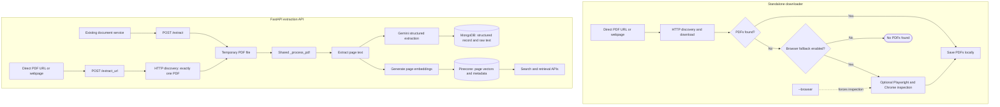
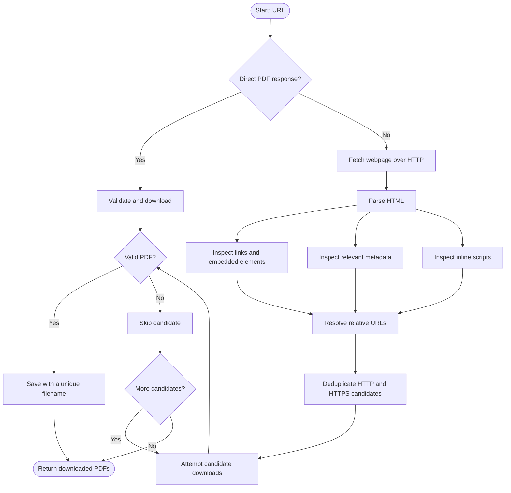
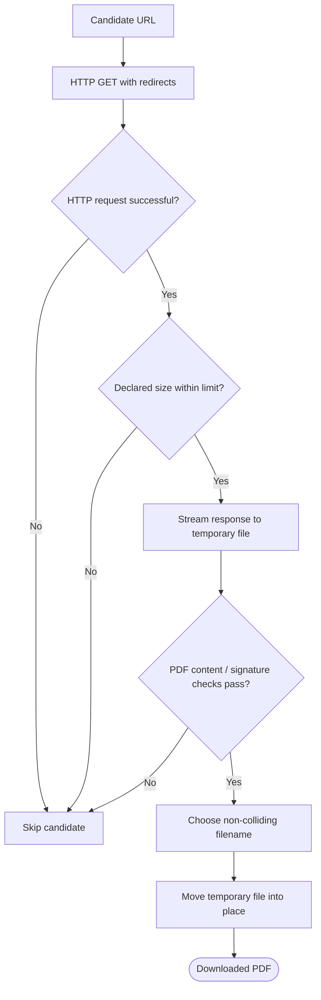
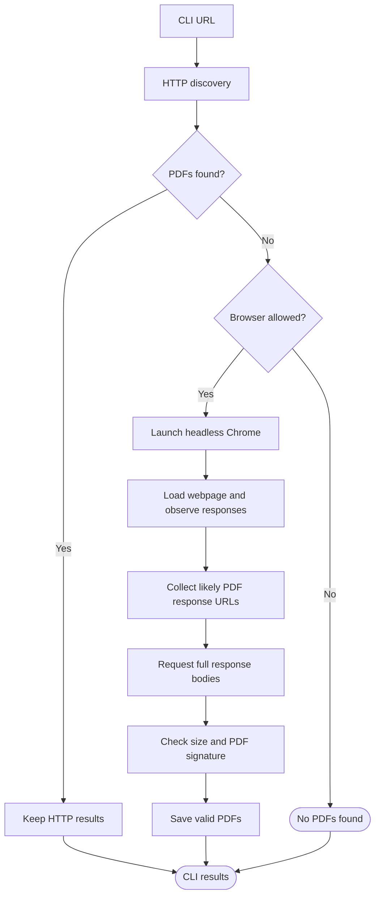
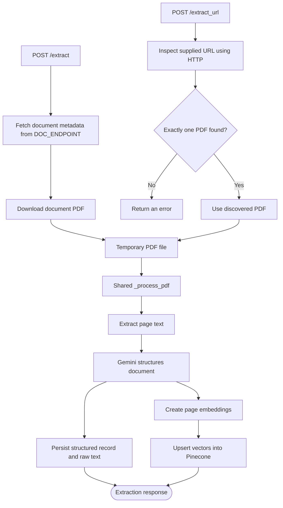
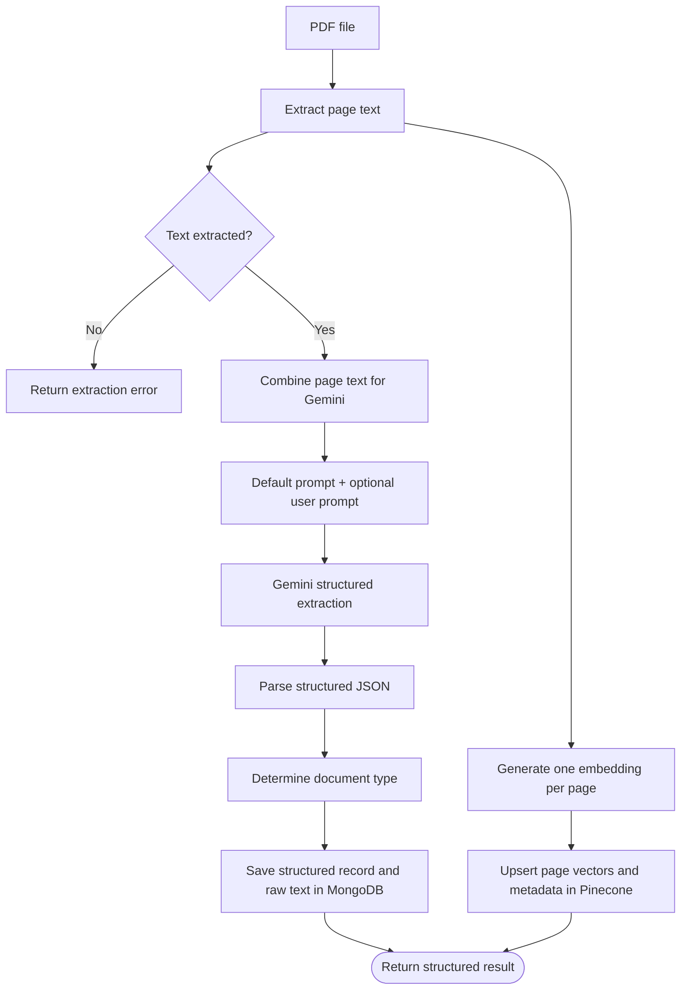

<div align="center">

# PDF Extractor

### From scattered PDF links to structured, searchable documents.

**Discover. Download. Extract. Understand. Retrieve.**

[](https://www.python.org/)
[](https://fastapi.tiangolo.com/)
[](https://ai.google.dev/)
[](https://www.mongodb.com/)
[](https://www.pinecone.io/)

*A Python PDF discovery and legal-document extraction system, with a standalone downloader and an API-backed document intelligence pipeline.*

</div>

---

## What is PDF Extractor?

PDF Extractor brings together two useful capabilities:

1. **Find and download PDFs** — give the downloader a webpage or a direct PDF URL. It inspects common HTML document references, resolves links, validates responses, and saves accessible PDFs locally.
2. **Extract and retrieve document information** — submit a PDF through the FastAPI service. The service extracts page text, uses Gemini to structure the document, stores the result in MongoDB, and indexes page-level text in Pinecone for semantic retrieval.

You can use the downloader independently, or use the extraction API as part of a larger application.

## At a glance

| Capability | What it does |
|---|---|
| Webpage discovery | Finds PDF candidates in links, embedded elements, metadata, and inline scripts |
| Direct downloads | Accepts a direct PDF URL without requiring a webpage |
| Response validation | Checks PDF content and signature before keeping a download |
| Bounded streaming | Streams HTTP downloads with a default 200 MiB limit |
| Browser-assisted CLI | Optionally inspects browser network responses using Playwright and Chrome |
| Document extraction | Extracts page text and structures document information with Gemini |
| Persistent records | Stores structured output and raw page text in MongoDB |
| Semantic retrieval | Embeds page text and indexes it in Pinecone |
| Scoped search | Supports global, workspace-level, and document-targeted retrieval |

---

## The system, visually

The repository contains two separate workflows: a standalone downloader that saves PDFs locally, and an API pipeline that extracts and indexes documents.



> **Important distinction:** `/extract_url` uses HTTP discovery only. Browser-assisted inspection is an optional feature of the standalone CLI; the API route does not launch Chrome or Playwright.

## 1. Standalone PDF downloader

The downloader is a Python package with a command-line interface. It can be used independently of the FastAPI extraction service.

### How discovery works



The HTTP discovery engine inspects:

- `<a href="...">` links containing `.pdf` references.
- `iframe`, `embed`, `object`, and `source` document references.
- Relevant metadata entries, including document-related and Open Graph URL fields.
- PDF URL patterns in inline scripts.

It resolves relative references against the final webpage URL and deduplicates candidate URLs before attempting downloads.

### Download validation

Finding a URL is not enough. A webpage may point to an HTML error page, a login screen, or another non-PDF response.



The downloader:

- Streams HTTP response bodies instead of loading the entire download into memory.
- Enforces a default maximum download size of **200 MiB**.
- Checks PDF content indicators and the `%PDF-` file signature.
- Uses a temporary `.part` file while downloading.
- Avoids overwriting existing files by choosing a unique destination name.
- Skips failed or invalid candidates so other discovered candidates can still be attempted.

### Browser-assisted discovery

Some websites populate document URLs only after JavaScript executes. The standalone CLI can optionally use Playwright with an installed Chrome/Chromium executable to inspect successful network responses and attempt full PDF downloads.



The CLI's browser behavior is:

| Mode | Behavior |
|---|---|
| Default | Try HTTP discovery first; use browser inspection if no PDFs were found |
| `--browser` | Inspect with Chrome even if HTTP discovery already found PDFs |
| `--no-browser` | Disable browser fallback |

Browser inspection requires the optional Playwright dependency and an installed Chrome/Chromium executable. It does not automatically download a browser bundle.

---

## 2. Legal-document extraction pipeline

The FastAPI service accepts documents through two acquisition routes. Both eventually call the same `_process_pdf` function.

### Two ways in, one processing pipeline



**`POST /extract`** uses the existing document-service integration. It looks up the document using `DOC_ENDPOINT`, downloads the PDF, and passes it to the shared processor.

**`POST /extract_url`** accepts either a direct PDF URL or a webpage URL. The supplied page must expose exactly one downloadable PDF. If it exposes none or multiple PDFs, the request is rejected rather than silently selecting a document.

### Inside the shared processor



The stored MongoDB record includes the document ID, workspace ID, detected document type, structured extraction, and raw page text. Pinecone receives page-level vectors with metadata such as document ID, workspace ID, page ID, and text.

---

## 3. Quick start: downloader

### Requirements

- Python **3.12 or newer**.
- Network access to the target webpage and PDF resources.
- Optional: installed Chrome/Chromium and Playwright for browser-assisted inspection.

### Install

```bash
git clone https://github.com/Pranay-Pandey/Pdf-extractor.git
cd Pdf-extractor

python3 -m venv .venv
source .venv/bin/activate

python -m pip install -e .
```

For development and tests:

```bash
python -m pip install -e '.[dev]'
```

For browser-assisted discovery:

```bash
python -m pip install -e '.[browser]'
```

### Download a PDF

Discover and download PDFs linked from a webpage:

```bash
pdf-extractor "https://example.com/document-page"
```

Download a direct PDF URL:

```bash
pdf-extractor "https://example.com/document.pdf" --output-dir ./downloads
```

Force browser inspection:

```bash
pdf-extractor "https://example.com/document-page" --browser
```

Disable browser fallback:

```bash
pdf-extractor "https://example.com/document-page" --no-browser
```

### CLI reference

| Option | Description | Default |
|---|---|---|
| `URL` | Webpage URL or direct PDF URL | Required |
| `--output-dir PATH` | Directory in which to save downloads | `./output` |
| `--browser` | Always inspect the page using Chrome | Off |
| `--no-browser` | Disable automatic browser fallback | Off |
| `--chrome PATH` | Chrome executable path | `/usr/bin/google-chrome` |
| `--timeout SECONDS` | HTTP and browser timeout | `30` |

`--browser` and `--no-browser` cannot be used together.

### Use the Python package

The discovery and HTTP download functions can also be imported from Python:

```python
from pathlib import Path

from pdf_extractor.core import inspect_http

results = inspect_http(
    "https://example.com/document-page",
    Path("./downloads"),
)

for pdf in results:
    print(pdf.path, pdf.size, pdf.url)
```

`inspect_http` returns a list of `DownloadedPDF` results. Each result contains the saved path, final URL, and downloaded size.

---

## 4. Quick start: extraction API

The extraction API is a separate part of the repository from the standalone downloader. It requires the service dependencies and configured external services.

### Install service dependencies

```bash
python -m pip install -r requirements.txt
python -m pip install -e .
```

### Configure environment

Create a `.env` file in the project root:

```dotenv
MONGO_URI=mongodb://localhost:27017
MONGO_DB=pdfextractor
MONGO_COLLECTION=documents

DOC_ENDPOINT=https://your-document-service.example

PINECONE_API_KEY=your-pinecone-api-key
PINECONE_INDEX=doc-chunks

GEMINI_API_KEY=your-gemini-api-key
```

| Variable | Purpose | Default |
|---|---|---|
| `MONGO_URI` | MongoDB connection URI | None |
| `MONGO_DB` | MongoDB database | `pdfextractor` |
| `MONGO_COLLECTION` | MongoDB collection | `documents` |
| `DOC_ENDPOINT` | Existing document-service base URL used by `/extract` | None |
| `PINECONE_API_KEY` | Pinecone API key | None |
| `PINECONE_INDEX` | Pinecone index name | `doc-chunks` |
| `GEMINI_API_KEY` | Gemini API key | None |

The API initializes its MongoDB, Pinecone, and Gemini integrations at startup. Ensure those services and credentials are available before launching it.

### Start the API

```bash
uvicorn main:app --host 0.0.0.0 --port 8000
```

Health check:

```bash
curl http://localhost:8000/health
```

Expected response:

```json
{"status":"healthy"}
```

The repository also includes a Streamlit interface:

```bash
streamlit run app.py
```

---

## 5. API reference

All request examples below use JSON bodies.

### Extract through the existing document service

`POST /extract`

Fetches a document through `DOC_ENDPOINT` using the workspace and document identifiers, then processes the downloaded PDF.

```bash
curl -X POST http://localhost:8000/extract \
  -H 'Content-Type: application/json' \
  -d '{
    "workspace_id": "workspace-123",
    "doc_id": "document-456",
    "prompt": "Extract the parties and relevant dates"
  }'
```

Request fields:

| Field | Type | Required | Description |
|---|---|---|---|
| `workspace_id` | string | Yes | Workspace associated with the document |
| `doc_id` | string | Yes | Document identifier |
| `prompt` | string | No | Additional extraction instructions |

### Extract from a URL

`POST /extract_url`

Accepts a direct PDF URL or a webpage exposing exactly one downloadable PDF.

```bash
curl -X POST http://localhost:8000/extract_url \
  -H 'Content-Type: application/json' \
  -d '{
    "workspace_id": "workspace-123",
    "doc_id": "document-789",
    "url": "https://example.com/document.pdf",
    "prompt": "Extract the parties and relevant dates"
  }'
```

In addition to the fields above, this endpoint requires:

| Field | Type | Required | Description |
|---|---|---|---|
| `url` | string | Yes | Direct PDF URL or webpage URL |

A page exposing zero or multiple PDFs is rejected. Supply a direct PDF URL or a page that identifies exactly one downloadable PDF.

### Search indexed document chunks

`POST /search`

Searches the Pinecone index using a query embedding.

```json
{
  "query": "What are the conditions for bail?",
  "top_k": 5
}
```

### Search within a workspace

`POST /workspace_search`

Restricts the vector search to a workspace.

```json
{
  "query": "What are the conditions for bail?",
  "workspace_id": "workspace-123",
  "top_k": 5
}
```

### Retrieve across documents or a workspace

`POST /multi_retrieve`

When `doc_ids` is provided, the service queries each specified document within the workspace, combines the matches, and sorts them by score. If `doc_ids` is omitted, it performs a single search filtered to the workspace.

```json
{
  "query": "Find references to the incident date",
  "workspace_id": "workspace-123",
  "doc_ids": ["document-456", "document-789"],
  "top_k": 5
}
```

### Endpoint summary

| Method | Endpoint | Purpose |
|---|---|---|
| `GET` | `/health` | Health check |
| `POST` | `/extract` | Extract a document fetched through `DOC_ENDPOINT` |
| `POST` | `/extract_url` | Discover/download one PDF from a supplied URL and extract it |
| `POST` | `/search` | Search indexed chunks globally |
| `POST` | `/workspace_search` | Search chunks within a workspace |
| `POST` | `/multi_retrieve` | Retrieve and rank results across selected documents or a workspace |

Interactive API documentation is available at `/docs` when the FastAPI service is running.

---

## 6. Project structure

```text
pdf-extractor/
├── .gitignore
├── README.md
├── src/
│   └── pdf_extractor/
│       ├── __init__.py
│       ├── core.py          # HTTP discovery, candidate validation, PDF downloads
│       ├── browser.py       # Optional Playwright / Chrome inspection
│       └── cli.py           # Command-line interface
│
├── .devcontainer/
│   └── devcontainer.json
│
├── tests/
│   └── test_pdf_downloader.py
├── test_chunk_text.py
├── test_extract_text_from_pdf.py
│
├── main.py                 # FastAPI extraction and retrieval endpoints
├── app.py                  # Streamlit interface
├── OCR.py                  # Gemini vision-based page OCR used by the FastAPI pipeline
├── extract_service.py      # Existing extraction service integration
├── extract_service_gemini.py
├── stm/
│   └── requirements.txt
├── requirements.txt        # Extraction service dependencies
├── pyproject.toml          # Downloader package and development configuration
├── vercel.json             # Vercel deployment configuration
└── .github/
    └── workflows/
        └── tests.yml
```

### Main components

| Component | Responsibility |
|---|---|
| `core.py` | HTML discovery, URL resolution, deduplication, HTTP downloads, and PDF validation |
| `browser.py` | Optional browser-driven network response inspection and PDF capture |
| `cli.py` | Argument parsing and orchestration of HTTP and browser discovery |
| `main.py` | FastAPI endpoints, document processing, persistence, and retrieval |
| `OCR.py` | Renders PDF pages to images and extracts page text with Gemini 2.0 Flash vision OCR; used by the FastAPI pipeline |
| `app.py` | Streamlit application interface |
| `tests/` | Downloader behavior tests |

---

## 7. Engineering choices

A few implementation decisions are intentional:

- **Discovery is separate from extraction.** The downloader can be used without Gemini, MongoDB, Pinecone, or the FastAPI service.
- **Candidate URLs are deduplicated.** The same PDF referenced in multiple parts of a page is not needlessly treated as multiple candidates.
- **A URL is not assumed to be a PDF.** Downloaded content is checked before it is retained.
- **HTTP downloads are bounded and streamed.** The downloader applies a 200 MiB default limit and writes to a temporary file before finalizing a download.
- **Browser support is optional.** HTTP discovery runs first; browser inspection is used as a fallback when no PDFs are found, or can be forced with `--browser`.
- **Non-unique API input is rejected.** `/extract_url` requires exactly one discovered PDF and rejects requests that return zero or multiple PDFs.
- **Both API acquisition routes converge.** `/extract` and `/extract_url` reuse the same PDF processing function.
- **Page-level indexing preserves context.** Pinecone metadata includes document, workspace, page, and text fields for retrieval.

---

## 8. Security and limitations

PDF Extractor is designed for documents that are publicly accessible or that you are authorized to access.

It does **not** bypass:

- Login requirements or private access controls.
- Paid subscriptions or paywalls.
- DRM or document encryption.
- Server-side restrictions or authorization checks.

Discovery can be limited by sites that:

- Generate PDF URLs only after complex JavaScript execution.
- Require authenticated browser sessions or cookies.
- Block automated HTTP or browser requests.
- Render documents as images or canvas elements without exposing a downloadable PDF response.
- Require request headers or application state that the downloader does not have.

Browser inspection can help with some JavaScript-driven pages, but it is not a universal document capture mechanism. The `/extract_url` API route uses HTTP discovery only and does not use browser inspection.

### Deployment warning: URL fetching

`/extract_url` accepts a caller-supplied URL and causes the service to make outbound requests. Treat this endpoint as a privileged capability.

Before exposing it beyond a trusted environment:

- Require authentication and authorization.
- Apply outbound network and destination-host restrictions at the deployment boundary.
- Prevent access to internal services and sensitive network ranges.
- Apply request, timeout, and resource limits appropriate to your environment.
- Monitor and log URL extraction activity.

The application should not be treated as providing complete SSRF protection by itself.

---

## 9. Development and tests

Install development dependencies:

```bash
python -m pip install -e '.[dev]'
```

Run the test suite:

```bash
pytest
```

Run lint checks:

```bash
ruff check src/pdf_extractor tests/test_pdf_downloader.py
```

Check formatting and whitespace in the Git diff:

```bash
git diff --check
```

The configured pytest test path is `tests/`. The root-level `test_chunk_text.py` and `test_extract_text_from_pdf.py` are separate helper/test scripts and are not included in that configured test directory.

---

## 10. Current scope

| Area | Current behavior |
|---|---|
| HTTP webpage discovery | Supported |
| Direct PDF downloads | Supported |
| HTML and inline-script candidate discovery | Supported |
| PDF signature validation | Supported |
| Download size limit | 200 MiB default |
| Optional browser inspection in CLI | Supported with Playwright and installed Chrome/Chromium |
| Browser inspection in `/extract_url` | Not supported; HTTP discovery only |
| Multiple-PDF selection in `/extract_url` | Rejected as ambiguous |
| Page text extraction and Gemini structured extraction | Supported through the FastAPI pipeline |
| MongoDB persistence | Supported |
| Pinecone indexing and retrieval | Supported |
| Authentication / complete SSRF protection built into URL route | Not provided; deployment controls required |

---

<div align="center">

**PDF Extractor**

*Turn accessible PDF documents into structured information you can retrieve.*

</div>
